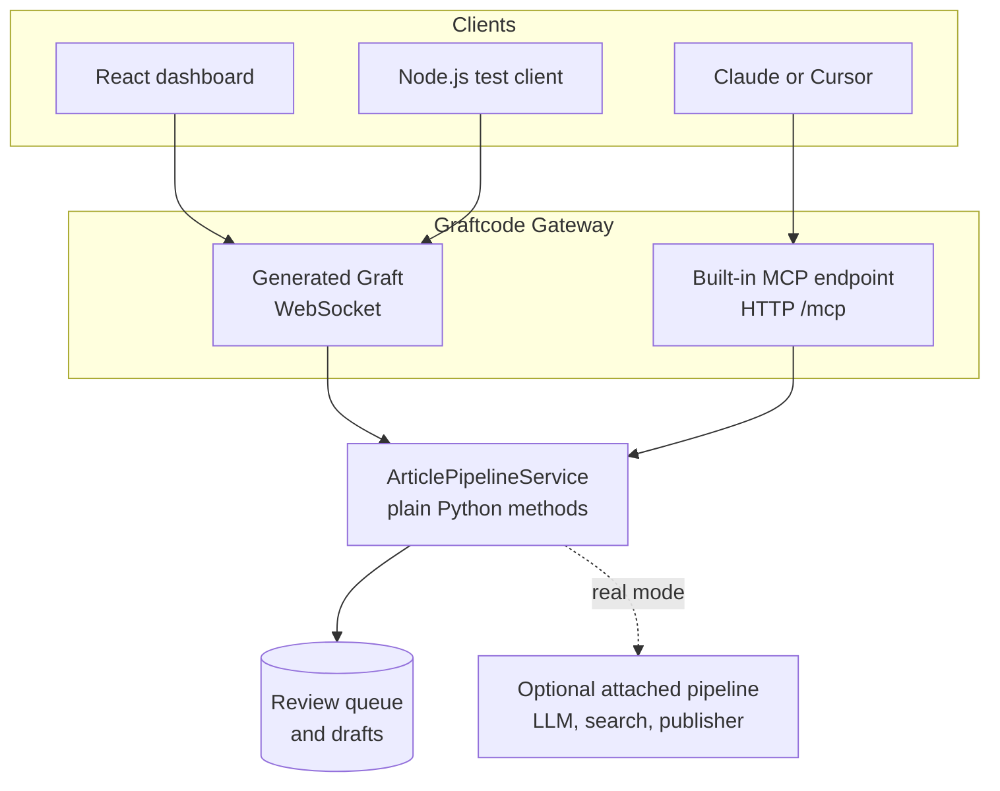
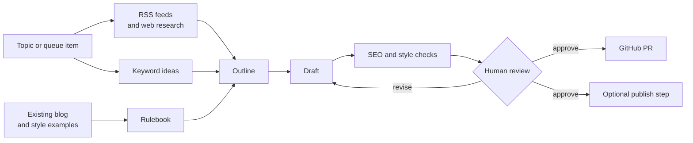

# Architecture and workflow

This page is a visual companion to the Pipeline Studio README. It explains how clients reach
the Python receiver and how an editorial idea moves through the workflow.

## Runtime architecture

There is one implementation of the receiver methods. The generated Graft and built-in MCP
surface are two access paths to that same implementation.

## Editorial workflow

## Demo mode versus real mode

| Mode | What the user sees | External cost |
|---|---|---|
| Demo mode | Bundled topics and drafts, placeholder writing, local checks | No provider keys required |
| Real mode | Attached research, LLM writing, live queue, and GitHub staging | Uses configured providers and repository |

The human-review boundary is intentional. The workflow can prepare a draft and stage a change,
but a person should inspect the content before a real publication step.

## Recommended demo capture

Capture these states in order for a walkthrough:

1. the dashboard and available pipeline methods;
2. a topic with its source material;
3. a generated draft and its style/SEO result;
4. the Architecture tab showing both access paths;
5. the GitHub staging result in a test repository.

Never include API keys, personal access tokens, private repository URLs, or unpublished customer
content in screenshots.
